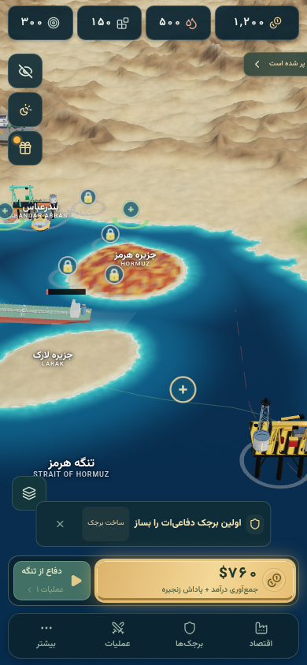

# Mobile rebuild — engineering record

The target remains the owner's Persian portrait Android game: one geographic Hormuz world, real export shipping, idle industry feeding tactical tower defense, six tower families with branching upgrades, and 25 campaign operations. The current user instruction authorizes rebuilding integration and UI; earlier decisions that preserved the old shell are superseded where they conflict.

## Defects found and changes

- Render shipping paths were independently splined from a different dataset. Numerical comparison against simulation found up to 390 world units of disagreement on trade traffic, 308 on pirates, 135 on port traffic, and 8 on enemies. `world-lane.ts` now projects the simulation's sampled lanes directly. The displayed route also uses this source. Test coverage checks 4,004 positions.
- All three commander choices used a research-vessel model. They now display frigate, carrier and submarine hulls; switching commander invalidates the old visual. The submarine boss now has a submarine hull.
- Buildings used one exported model plus generic boxes for upgrades. `scripts/export-buildings.cjs` now exports 55 authored models (11 buildings, five tiers) from the original pack. `terrainBase=false` removes the pack's presentation islands so they are not stacked on the world terrain. Tier changes load the authored replacement before removing the previous model.
- Portrait screenshot review exposed an oversized offshore derrick obscuring shipping. Offshore footprints are now seven world units and all building silhouettes are capped at 8.5 units high, preserving their proportions.
- Static GLB parts are batched by material and vertex layout. Animated subtrees, skinning, morphs, transparent parts and metadata-bearing nodes are excluded. Tests assert unchanged triangle count and bounds and surviving articulated nodes. Kenney ship textures/material properties are preserved instead of discarded by the monochrome conversion.
- Startup preloads basic defenses and first-tier buildings rather than every future upgrade. Failed requests can retry. The existing loading timeout is still a fallback, not proof that every model loaded.
- Four persistent navigation controls, full-height world viewport, compact resource HUD, 44px minimum controls, safe-area spacing; city and research remain available through command navigation. Persian/RTL retained.
- Android portrait/immersive mode, native Back handling, App lifecycle and Haptics plugins. Background combat pauses; return requires manual continuation. Audio suspends. Page hide saves. Local daily receipts support offline native play and clock rollback/replay protection. Local save tampering cannot be made cheat-proof without server authority.
- Fixed simulation steps with bounded catch-up preserve shot/event records across a multi-step update. Pinch/drag/cancel cannot become an accidental tap/strike. 3D work skips hidden documents.
- FPS display is diagnostic-only and reads the renderer's measured cadence. Browser rAF counts are no longer presented as rendered FPS.
- Root TypeScript excludes the independent Vite reference projects. Shared economic tuning is in `src/lib/balance.ts`; daily rewards, tower definitions and campaign composition retain their existing data modules.

## Reproduce

Node 24, Python 3 and Chromium were used. `npm ci`; `npm run test:core`; `npm run typecheck`; `npm run balance:report`.

Web: set DATABASE_URL to a local PostgreSQL database, apply `npx drizzle-kit push`, then `npm run dev`.

Android: `npm run build:android`; with JDK 21 and Android SDK 35 configured, `cd android && ./gradlew assembleDebug`. The debug APK is not a signed store release.

Asset regeneration: install the lockfile in `first-asset/gun-building-opus-muse`, start its Vite server on port 3400, then run `node scripts/export-buildings.cjs` from the repository root. The reference project resolves its missing Kenney source files from the already licensed copies in `public/models/kenney`. No purchased or newly downloaded third-party art was added.

## Evidence and limits

The original scene probe passed before modification at 1,281 draw calls. After batching it passed at 445. After authored first-tier buildings, the mobile browser sample reported 310 calls / 426,766 triangles. These are different captured moments, not a controlled phone benchmark; software-renderer FPS is not phone FPS.

Hydration/runtime (28 checks), navigation for both layouts, progression, mobile-core regression checks and the 55-file asset catalog checks passed. The existing fresh-player wave-3 gate passed both opening and mission strategies on all seven attempts each. The 18 tower animation cases and building idle check passed after batching, before the new building exports. Motion detection alone does not establish visual quality or correct targeting.

Production web and static Android builds passed. A debug APK build succeeded and its v1/v2 signatures verified. The mobile browser smoke test passed navigation, economy and an offline native daily claim without uncaught page errors. This emulates platform detection, not the Android hardware bridge. Reproduce with `TEST_URL=http://127.0.0.1:3310 node scripts/test-mobile-ui.cjs` against the static export. Final rebuild/test logs and screenshots are retained in `/workspace/game-review` and `/tmp` in this task.

Still unverified: sustained 60fps/thermals and lifecycle on a physical Android phone, touch feel on hardware, every tower's perceptual animation quality, all 25 operations and late-game economy over multi-day play. Existing repository lint debt has not been eliminated. This is a substantial repair build, not evidence that every requested release criterion is closed. Further acceptance must not be inferred from an APK or green unit tests.
