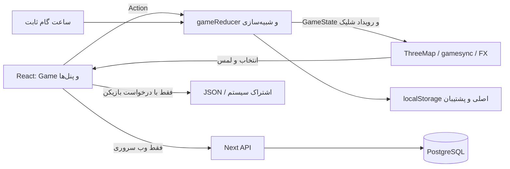

# معماری فنی تنگه هرمز — نسخهٔ 0.7.0

این سند تصویر کد موجود است، نه جایگزین [PRD](PRD.md)، [تصمیم‌ها](decisions.md) یا [وضعیت و کارهای باز](status.md). مبنا: سورس و پیکربندی مخزن در 2026-11-17. مشاهدهٔ پیاده‌سازی به‌تنهایی تأیید محصول یا نتیجهٔ تست روی گوشی نیست. برای نسخه‌های دقیق و بازتولیدپذیر وابستگی‌ها `package.json` و `package-lock.json` مرجع‌اند؛ ادعاهای تاریخی تست و پذیرش را از status بخوانید.

## نمای کلی و مرز اجرا

بازی یک برنامهٔ TypeScript با React 19.2.6، Next.js 16.4.6 و Three.js 0.187 است. رابط فارسی بازی اکشن به reducer می‌فرستد؛ شبیه‌سازی مالک وضعیت و قوانین است و صحنهٔ سه‌بعدی نمایش و ورودی نقشه را به آن متصل می‌کند. Capacitor 7 خروجی استاتیک وب را در WebView اندروید بسته‌بندی می‌کند. نسخهٔ سروری Next اختیاری است و مسیرهای ذخیره و جایزه را با PostgreSQL و Drizzle فراهم می‌کند؛ این سرور برای بازی بومی لازم نیست.



`src/app/page.tsx` ورودی بازی، `src/components/Game.tsx` هماهنگ‌کنندهٔ رابط، چرخهٔ عمر، ذخیره و ساعت و `src/lib/game.ts` تعریف `GameState`، `Action`، reducer، hydration و قواعد اصلی‌اند. `src/app/map3d/` مسیر نمای نقشه است. داده‌های سناریو و جغرافیا در `src/data/` و هندسه، مسیرها و منابع نقشه در `src/three-map/` قرار دارند. استایل‌ها در `src/app/*.css` و تصاویر، فونت‌ها و مدل‌های مورد استفاده در `public/` هستند.

## شبیه‌سازی، زمان و تصادف

`SimulationClock` در `src/lib/simulation-clock.ts` گام ثابت ۰٫۱۲۵ ثانیه دارد و در هر فراخوانی حداکثر چهار گام عقب‌افتاده اجرا می‌کند؛ تأخیر بیش از این بودجه حذف می‌شود و زمان پس‌زمینه نبرد را جلو نمی‌برد. سرعت بازی در قوانین بازی اعمال می‌شود. reducer برای `tick` از `cloneForTick` استفاده می‌کند: زیرشاخه‌های قابل‌تغییر تیک کپی می‌شوند و شاخه‌های فقط‌خواندنی به اشتراک می‌مانند؛ سایر اکشن‌ها کپی عمیق می‌گیرند. هر تغییر به تیک باید این قرارداد immutability را حفظ کند (`scripts/audit/test-tick-immutability.cjs`).

تصادف نبرد از xorshift با `rngState` ذخیره‌شده در وضعیت استفاده می‌کند؛ با وضعیت و ورودی و گام‌های یکسان، توالی نبرد قابل بازتولید است. تولید غنیمت مسیر seed خودش را در `src/lib/progression.ts` دارد؛ تصادف صرفاً بصری در رندر نباید نتیجهٔ بازی را تعیین کند. `shots` و `events` رویدادهای موقت‌اند، ولی آسیب پرتابه در `pendingImpacts` و پس از `flightDur` بر حسب زمان نبرد اعمال می‌شود. رندر FX باید همان مدت معتبر را مصرف کند؛ ساعت نمایشی جهان با زمان نبرد یکی فرض نشود. توقف، سرعت و بارگذاری نباید باعث اصابت دوباره یا جلو رفتن پنهان نبرد شوند.

حالت نبرد هنگام بازیابی ذخیره مکث می‌شود. پنهان‌شدن صفحه یا غیرفعال‌شدن اپ بومی ساعت را معلق و نبرد را مکث می‌کند؛ بازگشت پس از غیبت بیش از ۳۰ ثانیه مسیر اقتصاد آفلاین را جداگانه اجرا می‌کند. آماده‌نبودن یا خطای دنیا و پنجره‌های مکث‌کنندهٔ رابط مانند بولتن و دفترچه نیز نبرد را متوقف می‌کنند. این تمایز برای تغییر UI و lifecycle مهم است: مکث نبرد الزاماً به معنی توقف همهٔ رفتارهای صلح و اقتصاد نیست.

## دنیا و دارایی‌ها

`WorldView3D.tsx` و `ThreeMap.tsx` نصب و چرخهٔ عمر صحنه را مدیریت می‌کنند؛ `hormuz-map.js` جهان، `gamesync.ts` نگاشت موجودیت‌های بازی و انیمیشن، `models3d.ts` بارگذاری مدل‌ها، `ships3d.ts` شناورها، `battlefx.ts` افکت‌های pooled و `coords.ts` و `world-lane.ts` مختصات و مسیرها را نگه می‌دارند. لود مدل‌ها پویا و همراه پیش‌بارگذاری و pool است؛ مسیرهای رندر، هموارسازی حرکت، batch اشیای ثابت و تنظیم وضوح برای کاهش هزینهٔ فریم وجود دارند. اشیای متحرک GLB با نام‌های انیمیشن، از جمله نام‌های sanitizeشدهٔ loader، به updater متصل‌اند (`anim-names.ts`).

نصب صحنه و بارگذاری منابع ناهمگام‌اند: هنگام unmount باید listener، animation loop، منابع و کار معوق پاک‌سازی شوند و نتیجهٔ دیررس به صحنهٔ نابودشده متصل نشود. خطای ساخت یا بارگذاری دنیا باید به وضعیت آمادگی منتقل شود تا نبرد پشت نمای ناموفق اجرا نشود. بودجه و اهداف کارایی در D-020 ثبت‌اند؛ تحقق ۶۰ FPS و رفتار حرارتی روی گوشی واقعی با وجود بهینه‌سازی‌ها نیازمند پذیرش همان دستگاه است، نه استنتاج از مشخصات یا تست مرورگر.

مدل‌ها و مشتقات آن‌ها، منابع Innerscene و Kenney و اطلاعات جغرافیا و مجوزها در [CREDITS.md](../CREDITS.md) آمده‌اند. پک‌های مالک در `first-asset/` و خروجی‌های مصرفی در `public/models/` هستند. پیش از افزودن یا تبدیل مدل، مجوز، محور جلو، مقیاس، بودجهٔ هندسه و حفظ نام گره‌های انیمیشن را بررسی کنید؛ سیاست مدل‌های برجک و ساختمان در D-014 و D-019 را از تصمیم‌های مربوط بخوانید. وابستگی‌های نرم‌افزار و مجوز هر دارایی جداگانه باید بررسی شوند.

پک ساختمان در `first-asset/gun-building-opus-muse` با React Three Fiber ساخته شده است. callbackهای `useFrame` داخل GLB ذخیره نمی‌شوند؛ محورهای متحرک باید نام‌های `anim:*` و پارامترهای لازم در `userData` داشته باشند تا `gamesync` پس از بارگذاری و batching آن‌ها را حرکت دهد. خروجی جاری این قرارداد را برای جرثقیل، شعله/دود، پمپ، توربین، رادار، شناور، اسکنر، ترافیک و چراغ چشمک‌زن حفظ می‌کند. ساعت exporter متوقف است تا زمان طولانی اجرای export به pose متفاوت هر فایل منجر نشود.

برای بازتولید، در پوشهٔ پک `npm ci` و `npm run dev -- --host 127.0.0.1 --port 3400` را اجرا کنید؛ سپس از ریشه `node scripts/export-buildings.cjs` همهٔ ۵۵ GLB را می‌سازد. `test-asset-catalog.cjs` اعتبار و تمایز tierها و حفظ گره‌های متحرک را کنترل می‌کند. مخزن tier۱/۲، شهر tier۱/۲ و رفاه tier۱ در منبع، قطعهٔ متحرک ندارند؛ این پنج مدل عمداً ثابت‌اند. تست زندهٔ amplitude علاوه بر ۱۸ پیکربندی برجک، تغییر transform/scale/رنگ یا شدت نور ساختمان‌های دارای گرهٔ متحرک را اندازه می‌گیرد.

## ذخیره، بازیابی و انتقال

ذخیرهٔ اصلی محلی `hormuz-game-v1` و پشتیبان `hormuz-game-backup-v1` است (`src/lib/save-storage.ts`). پیش از جایگزینی اصلی، نسخهٔ قبلیِ قابل‌پارس تا حد امکان در پشتیبان نوشته می‌شود؛ خطای quota برای پشتیبان نباید مانع تلاش برای نوشتن اصلی شود و خطای ذخیره به بازیکن اعلام می‌شود. در شروع، ابتدا اصلی و سپس پشتیبان امتحان می‌شود. `hydrateGame` در `game.ts` ساختار را اعتبارسنجی، مقدارهای قدیمی یا نامعتبر را محدود یا با مقدار پیش‌فرض جایگزین و ذخیرهٔ خام نسخهٔ ۱ را به شکل جاری تکمیل می‌کند؛ ذخیرهٔ نامعتبر پذیرفته نمی‌شود. این شامل مرمت وضعیت نبرد، `pendingImpacts`، ساعت‌ها و وضعیت باس، هک و قهرمان است. `shots` و popupهای گذرا دوباره ساخته نمی‌شوند. برای تغییر قالب باید مهاجرت و تست ذخیرهٔ قدیمی را همراه تغییر اضافه کرد، نه صرفاً شمارهٔ نسخه را افزایش داد.

بازیکن از تنظیمات می‌تواند نسخهٔ کامل را به شکل JSON با envelope ‏`{format: "hormuz-save", version: 1, state}` صادر یا وارد کند (`SaveBackup.tsx`). واردکردن فایل تا ۲ MB، بررسی قالب و hydration، و تأیید جایگزینی را لازم دارد؛ رسیدهای روزانهٔ اعمال‌شده با رسیدهای دستگاه ادغام می‌شوند. در اندروید فایل ابتدا در cache با Filesystem ساخته و با Share به انتخاب کاربر سپرده می‌شود؛ در وب دانلود می‌شود (`src/lib/export-file.ts`). این نسخهٔ دستی باید در مقصدی خارج از داده‌های اپ نگهداری شود. `android:allowBackup="false"` است، پس پشتیبان خودکار سیستم اندروید جایگزین صادرات دستی نیست.

در وب سروری، `src/app/api/save/route.ts` داده را در `game_saves` به صورت JSONB ذخیره می‌کند. ردیف قدیمی خام نسخهٔ سرور صفر خوانده می‌شود و نوشتن جدید envelope حاوی نسخه و زمان دارد. POST با `baseVersion` و قفل تراکنشی برای هر شناسه compare-and-swap انجام می‌دهد؛ ناسازگاری 409 می‌دهد. کلاینت نوشتن سرور را متوقف می‌کند و تلاش می‌کند نسخهٔ سرور را جداگانه محلی نگه دارد؛ هیچ نسخه‌ای خودکار بر دیگری تحمیل نمی‌شود. ذخیرهٔ محلی همچنان ادامه دارد و امکان حل تعارض خودکار یا همگام‌سازی حساب وجود ندارد. شناسهٔ محلی نقش bearer دارد، احراز هویت یا حساب واقعی نیست؛ داشتن آن برای دسترسی به API کافی است. این مسیر را بدون طراحی امنیت و کنترل دسترسی مناسب، سرویس ابری امن چندکاربره تلقی نکنید.

جایزهٔ روزانه در وب سروری با `daily_rewards` و مرز روز تهران و تراکنش تکرارپذیر پیاده شده؛ اندروید از رسید محلی و ساعت دستگاه استفاده می‌کند (`local-daily.ts`). انتقال ذخیره و پاک‌کردن دادهٔ اپ با حساب و همگام‌سازی واقعی معادل نیستند. schema در `src/db/schema.ts` و اتصال در `src/db/index.ts` است؛ پیکربندی پایگاه داده و مهاجرت را پیش از راه‌اندازی سرور جداگانه بررسی کنید.

## آفلاین، پلتفرم و حریم داده

`next.config.ts` با `STATIC_EXPORT=1` خروجی `out/` می‌سازد؛ `scripts/build-android-web.mjs` هنگام build مسیرهای API و manifest را موقتاً کنار می‌گذارد و در `finally` بازمی‌گرداند، سپس `cap sync android` دارایی‌ها را در پروژهٔ بومی همگام می‌کند. `runtime.ts` درخواست‌های API را در خروجی استاتیک و runtime بومی غیرفعال می‌کند. دارایی‌های بازی در بسته قرار دارند؛ برای اجرای بومی به دریافت API یا CDN نیاز نیست. ثبت service worker/PWA حذف شده است؛ manifest وب به‌تنهایی تضمین نصب‌پذیری یا کار آفلاین وب نیست.

چهار افزونهٔ مورد استفاده Capacitor عبارت‌اند از App برای چرخهٔ عمر/دکمهٔ بازگشت، Haptics برای بازخورد، Filesystem و Share برای خروجی انتخابی کاربر. برنامهٔ بومی `ir.hormuz.sovereign`، حداقل SDK 23 و compile/target SDK 36 دارد. manifest با `allowBackup=false` و `fullBackupContent=false` پشتیبان خودکار را خاموش می‌کند؛ `res/xml/data_extraction_rules.xml` برای Android 12+ دامنه‌های داده را از cloud backup و device transfer کنار می‌گذارد. فایل‌های Gradle و manifest مرجع تنظیمات واقعی‌اند؛ تغییر رفتار در پس‌زمینه باید هم در مرورگر و هم در WebView بررسی شود.

تشخیص محلی `src/lib/analytics.ts` بدون ارسال خودکار شبکه، شناسهٔ نصب تصادفی و رویدادهای session، شروع/برد/باخت نبرد، مأموریت و prestige را در `hormuz-diagnostics-v1` نگه می‌دارد. حضور روزانه به UTC deduplicate می‌شود؛ حضور روزهای D0 تا D20 نصب و ۹۰ حضور اخیر و حداکثر ۴۰۰۰ رویداد جزئی نگهداری می‌شود. پاک‌کردن داده یا نصب مجدد شناسهٔ تازه می‌سازد. صادرات JSON تنها به درخواست بازیکن است. `scripts/retention-report.cjs` خروجی‌ها را با شناسهٔ نصب ادغام می‌کند و retention دقیق روز ۲۰ UTC را فقط برای cohortهای بالغ محاسبه می‌کند؛ این دادهٔ محلی به‌تنهایی اندازهٔ کل جمعیت بازیکنان را نشان نمی‌دهد.

## توسعه، تست و ساخت

پیش‌نیاز وب Node و npm سازگار با lockfile است؛ برای Android، JDK 21، Android SDK شامل platform/build tools لازم، و تنظیم `JAVA_HOME` و `ANDROID_HOME` یا `ANDROID_SDK_ROOT` لازم‌اند. wrapper پروژه Gradle 8.11.1 و Android Gradle Plugin 8.9.1 را مشخص می‌کند. از ریشه:

```bash
npm ci
npm run dev
npm run verify
npm run build:android
cd android
./gradlew assembleDebug
./gradlew bundleRelease
```

`verify` شامل typecheck، lint، تست‌های core، integrity، campaign و پروب‌های مکانیک و تیک است؛ تعریف دقیق همیشه در `package.json` است. `test:audit` و `test:audit2`، تست‌های مرورگر و ابزارهای گزارش balance و retention جداگانه‌اند و همه جزو `verify` نیستند. `build:android` فقط خروجی وب می‌سازد و با پروژهٔ بومی sync می‌کند؛ دستورهای Gradle بستهٔ اندرویدی می‌سازند. این دستورها در این سند نتیجهٔ موفقیت build، امضای انتشار یا پذیرش گوشی را اثبات نمی‌کنند.

پیکربندی release در `android/app/build.gradle` در صورت وجود `HORMUZ_KEYSTORE` از آن و متغیرهای `HORMUZ_STORE_PASSWORD`، `HORMUZ_KEY_ALIAS` و `HORMUZ_KEY_PASSWORD` برای امضا استفاده می‌کند. مقدارها و keystore را وارد مخزن یا مستندات نکنید. نبود پیکربندی امضای مالک به معنی آماده‌بودن خروجی برای انتشار نیست؛ وضعیت فعلی کلید و ساخت را در status و راهنمای انتشار بررسی کنید.

## الگوی تغییر و مسیر آینده

برای افزودن مکانیک، داده و قوانین قطعی را در لایهٔ simulation تعریف، اکشن و اعتبارسنجی hydration و مهاجرت را همراه آن به‌روزرسانی و خروجی نمایشی را از وضعیت یا رویداد استخراج کنید. برای ویژگی بصری، بدون تغییر تصادف نبرد یا واردکردن عوارض جانبی به reducer، اتصال و cleanup صحنه را بررسی کنید. برای مدل جدید قرارداد نام گره، جهت و مجوز را ثبت و تست بارگذاری و بودجهٔ صحنه را اجرا کنید. برای تغییر ذخیره، نسخهٔ قدیمی، recovery، quota، قطع برنامه و تعارض سرور را در تست‌های مرتبط بررسی کنید. برای تغییر API تفاوت وب و خروجی استاتیک و نبود احراز هویت را در طراحی لحاظ کنید.

انتقال احتمالی به Unity فقط مسیر آینده است: در این مخزن پیاده‌سازی Unity وجود ندارد. انتقال واقعی نیازمند بازپیاده‌سازی یا انتقال قابل‌اعتماد قواعد reducer، ساعت ثابت، RNG و seed، قالب و مهاجرت ذخیره، سناریوها، رفتار آفلاین، دارایی‌ها و مجوزها و نیز مقایسهٔ نتایج با fixtureهای مشترک است؛ وجود مدل GLB به‌تنهایی معادل انتقال رفتار بازی نیست.
